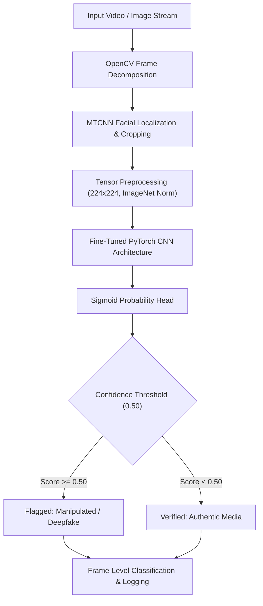

# Deepfake Detector — Computer Vision Media Forensics Pipeline


A computer vision research and inference pipeline engineered to detect synthetic and manipulated facial media (deepfakes). The system processes video streams and image collections through automated frame decomposition, facial landmark extraction via MTCNN, standard tensor normalization, and deep neural binary classification.

---

## 🏛️ Pipeline Architecture



---

## 🔬 Key Engineering Features

1. **Automated Frame Extraction:** Decomposes video streams into sequential image frames using OpenCV (`cv2.VideoCapture`) with configurable sampling rates (`practice_coding/02_vid_to_frames.py`).
2. **MTCNN Facial Landmark Cropping:** Eliminates background noise by isolating facial regions with bounding-box margin buffers (`practice_coding/cropping_images_mtcnn.py`).
3. **Fine-Tuning & Model Training:** Custom PyTorch training pipeline implementing Cross-Entropy loss, Adam optimization, learning rate scheduling, and data augmentations (`Training_new/fine_tuning.py`).
4. **Benchmark Evaluation:** Evaluated against benchmark media criteria, tracking precision, recall, and frame-level ROC-AUC (`Research/Research_papers_Secondary_data/`).

---

## 📁 Directory Structure

```
Deepfake_detector/
├── Training_new/
│   ├── app.py                     # Inference entrypoint and evaluation web app
│   ├── deepfake_detector.py       # Core detector inference class
│   ├── evaluate_model.py          # Validation metrics calculation script
│   └── fine_tuning.py             # PyTorch model fine-tuning routine
├── Research/
│   └── Research_papers_Secondary_data/
│       └── DeepFake-Eval-2024 Benchmark.txt
└── practice_coding/
    ├── 01_image_cropping.py       # OpenCV baseline image processing
    ├── 02_vid_to_frames.py        # Video decomposition module
    ├── cropping_images_mtcnn.py   # MTCNN face alignment and isolation
    └── file_handling_and_image.py # Dataset parsing utility
```

---

## 🚀 Quickstart & Execution

### 1. Clone & Set Up Virtual Environment
```bash
git clone https://github.com/sultanriaz/Deepfake_detector.git
cd Deepfake_detector
python -m venv venv
# On Linux/macOS:
source venv/bin/activate
# On Windows:
.\venv\Scripts\Activate.ps1
```

### 2. Install Dependencies
```bash
pip install torch torchvision opencv-python facenet-pytorch numpy pandas matplotlib
```

### 3. Run Inference & Web Interface
```bash
python Training_new/app.py
```
